  

  

  

  

Versión en texto

**Julián David Rincón Andrade**, desarrollador web junior en Cúcuta, Colombia.
Tecnólogo en Análisis y Desarrollo de Software (SENA, 2026) y estudiante de Ingeniería de Sistemas en la Universidad de Pamplona.
Busco mi primer empleo como desarrollador web junior, en Cúcuta o remoto.

- **Intranet Comfaoriente.** Plataforma en producción para la rectoría, la coordinación y 47 docentes. React, TypeScript, Firebase, Google Apps Script. [Repositorio](https://github.com/Judarin15/Intranet)
- **TechMarket.** E‑commerce de electrónica y gaming. React, Vite, Supabase, Figma. [Repositorio](https://github.com/Judarin15/TechMarket)
- **Galaxia Sonora.** Tienda de audiolibros en español. [galaxiasonora.com](https://galaxiasonora.com/)
- **Portafolio.** [portafolio-de-proyectos-julian.web.app](https://portafolio-de-proyectos-julian.web.app/)

Contacto: judarin11@gmail.com

